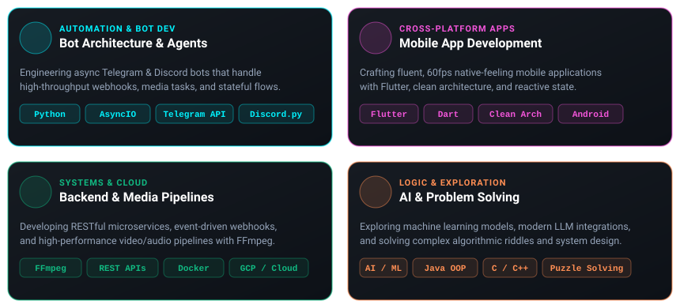

<div align="center">

  <!-- Dynamic Gradient Wave Banner -->
  

  <!-- Dynamic Typing SVG Header -->
  <a href="https://github.com/yedu-krish05">
    
  </a>

  <!-- Social Connect Badges -->
  <p align="center">
    <a href="https://t.me/Kr_i_s_h" target="_blank">
      
    </a>
    <a href="https://instagram.com/yedu__krish" target="_blank">
      
    </a>
    <a href="https://github.com/yedu-krish05" target="_blank">
      
    </a>
  </p>

</div>

---

<div align="center">
  <h2>⚡ Inside the Mind of the Developer</h2>
  <p><i>"Turning raw logic and curiosity into automated bots, responsive mobile apps, and scalable solutions."</i></p>

  <!-- Vector Bento Infographic (Custom Glowing Cards) -->
  <a href="https://github.com/yedu-krish05">
    
  </a>
</div>

<br/>

<!-- Sleek Terminal Telemetry -->
<div align="center">

```bash
yedu@workspace:~$ neofetch --profile
┌─ Identity ────────────────────────┐
│ Name    : Yedu Krishnan K         │
│ Role    : Bot & Mobile Engineer   │
│ Focus   : Python • Flutter • Java │
│ Cloud   : GCP • Docker • Render   │
│ Mindset : "Automate the Mundane"  │
│ Fuel    : ☕ 99% Dark Roast       │
└───────────────────────────────────┘
```

  <p align="center">
    
    
    
  </p>

  <p align="center">
    <i>💬 <b>Ask me about:</b> Asynchronous Python, Telegram APIs, Flutter Architecture, or Algorithmic Riddles!</i>
  </p>
</div>

---

### 🏆 GitHub Trophies

<div align="center">
  <a href="https://github.com/yedu-krish05">
    
  </a>
</div>

---

### 🛠️ Tech Stack & Arsenal

<div align="center">

#### 💻 Languages
<p>
  
  
  
  
  
  
</p>

#### 📱 Frameworks & Mobile / Bots
<p>
  
  
  
  
</p>

#### ☁️ Cloud, Databases & DevOps
<p>
  
  
  
  
  
  
</p>

#### 🧰 Tools & Design
<p>
  
  
  
  
  
</p>

</div>

---

### 📊 GitHub Activity & Analytics

<div align="center">
  <table border="0">
    <tr>
      <td>
        <!-- Overall Stats -->
        <a href="https://github.com/yedu-krish05">
          
        </a>
      </td>
      <td>
        <!-- Top Languages -->
        <a href="https://github.com/yedu-krish05">
          
        </a>
      </td>
    </tr>
  </table>

  <!-- Streak Stats Card (Active endpoint) -->
  <p align="center">
    <a href="https://github.com/yedu-krish05">
      
    </a>
  </p>
</div>

---

### 🤝 Let's Connect!

<p align="center">
  Got an idea for an awesome bot, cross-platform app, or automation tool? Let's talk!
</p>

<p align="center">
  <a href="https://t.me/Kr_i_s_h" target="_blank">
    
  </a>
  <a href="https://instagram.com/yedu__krish" target="_blank">
    
  </a>
  <a href="https://github.com/yedu-krish05" target="_blank">
    
  </a>
</p>

<!-- Visitor Counter -->
<p align="center">
  
</p>
